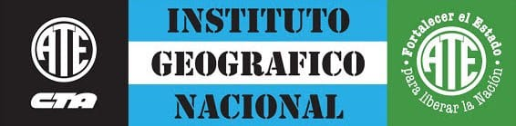
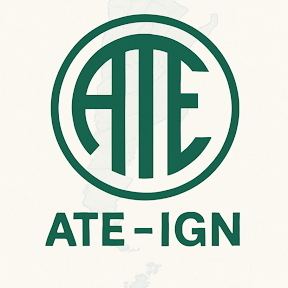

<!--

-->

Somos la Junta Interna de la Asociación de Trabajadores del Estado (ATE) del IGN. 
Mejorar la situación laboral en el Instituto es nuestro objetivo.

# ¿Tenés un problema? 

## ¡Hacete escuchar!
<!--
- [Pedí tu reintegro de coseguros Unión Personal](pages/up_reclamo.md)
-->
- [ART: ¿Qué hacer ante un accidente o enfermedad laboral?](pages/accidentes_trabajo.md)
- [Canal de comunicación anónima con la Junta Interna de ATE-IGN](https://framaforms.org/ate-ign-1763645579)

## CIOT | CyMAT
Para velar por la equidad y no discriminación, así como la seguridad e higiene laboral, el [Convenio Colectivo de Trabajo General para la Administración Pública Nacional](https://www.argentina.gob.ar/normativa/nacional/114315/actualizacion) establece reuniones entre representantes del estado empleador y sindicatos en dos comisiones.
Delegaciones de estas comisiones centrales están para atender estas problemáticas dentro del IGN.

### Comisión de Igualdad de Oportunidades y Trato
- [CIOT Central](https://www.argentina.gob.ar/jefatura/gestion-y-empleo-publico/ciot)
  - [¿Qué es la CIOT?](https://www.argentina.gob.ar/jefatura/gestion-y-empleo-publico/ciot/institucional) 
  
  <!---
  
  -->
- [¿Cómo presentar denuncias?](pages/ciot_denuncia.md)
- [Manual delegaciones CIOT](https://www.argentina.gob.ar/jefatura/gestion-y-empleo-publico/ciot/manual) 
  - [Presentación ATE para delegados CIOT 04-11-2025](<https://github.com/ateign/ateign.github.io/raw/refs/heads/main/docs/Presentación reunión CIOT 4-11-25.pdf>)
  - [Delegación CIOT del IGN](https://www.ign.gob.ar/content/CIOT)

### Comisión de Condiciones y Medio Ambiente de Trabajo
- [¿Qué es la CyMAT?](https://www.argentina.gob.ar/jefatura/gestion-y-empleo-publico/empleo-publico/cymat)
  - [Preguntas frecuentes CyMAT](https://www.argentina.gob.ar/jefatura/gestion-y-empleo-publico/cymat/preguntas)
- [Manual delegaciones CyMAT](https://www.argentina.gob.ar/sites/default/files/manual_delegaciones_cymat.pdf)
  
  - [Reglamento delegación CyMAT del IGN](https://www.ign.gob.ar/AreaInstitucional/RecursosHumanos/CyMAT)
  - [Presentación ATE para delegados CyMAT 03-06-2025](<https://github.com/ateign/ateign.github.io/raw/refs/heads/main/docs/CyMAT PDF.pdf>) 

# ATE Capital
- [Sitio web de ATE Capital](https://atecapital.org/)
- Beneficios para afiliados: [óptica, kits escolares, etc.](https://atecapital.org/beneficios)
  - [Turismo](https://atecapital.org/turismo)
- [Oferta educativa y formativa](https://formacion.atecapital.org/)
  - [Carrreras y cursos de universidades e institutos en convenio](https://formacion.atecapital.org/local/staticpage/view.php?page=oferta-educativa)
  - [Cursos cortos de ATE Capital con puntaje](https://formacion.atecapital.org/course/view.php?id=145)
